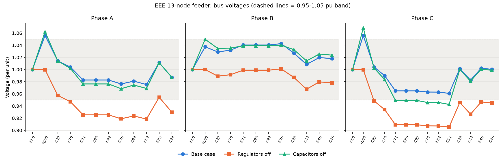
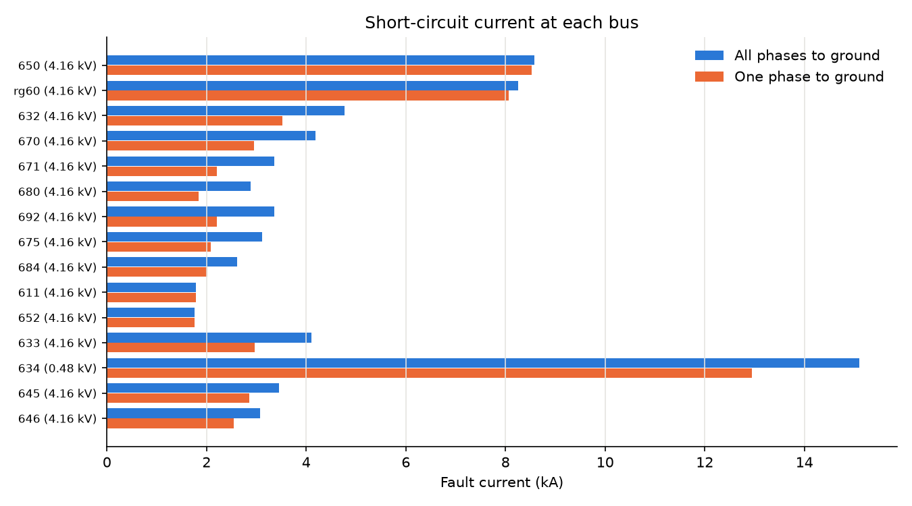
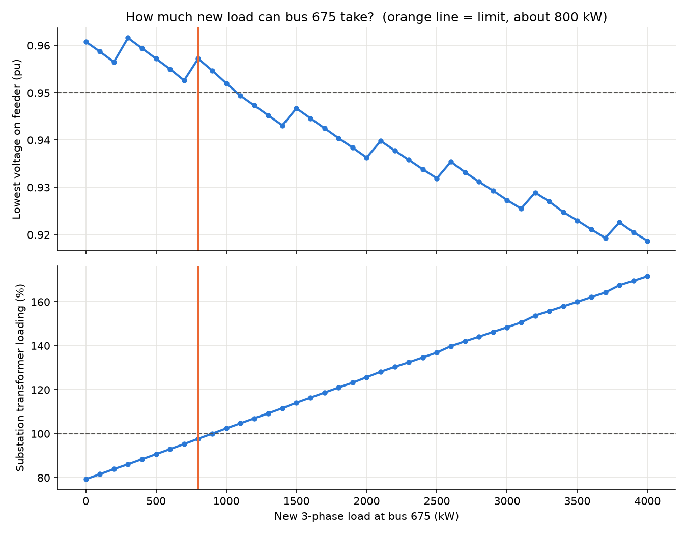

# IEEE 13-Node Distribution Feeder Study (OpenDSS + Python)

How much new load can a small utility feeder take, and what limits it? This project runs the studies a distribution planner runs (load flow, what-if cases, fault currents and hosting capacity) on the IEEE 13-node test feeder, using EPRI's OpenDSS engine controlled from Python.

The question behind it: when a large new customer, such as an EV charging hub or an edge data centre, asks to connect, what is the first thing that runs out?

## The feeder

The IEEE 13-node test feeder is a standard 4.16 kV distribution circuit. It has a 5 MVA substation transformer, three single-phase voltage regulators, two capacitor banks (600 kvar at bus 675, 100 kvar at bus 611) and unbalanced single- and three-phase loads.

## Studies

| # | Study | What it shows |
|---|-------|---------------|
| 0 | Model check | Bus voltages compared with the IEEE published results |
| 1 | Load flow | Per-unit voltage at every bus and phase |
| 2 | What-ifs | The same feeder with the regulators off, then with the capacitors off |
| 3 | Fault study | Fault current at every bus (all phases to ground, and one phase to ground), using the substation transformer's real 8% impedance |
| 4 | Hosting capacity | A new 3-phase load at a chosen bus, raised in 100 kW steps until a limit is hit |

The limits used in Study 4:

- Any bus below 0.95 pu
- A regulator reaching its last tap (±16 steps)
- The substation transformer above 100% of 5 MVA

**Model check:** every bus and phase matched the IEEE published voltages within 0.0013 pu (Study 0: PASS).

## Results: hosting capacity for a new large load

| Case | New load location | Power factor | Extra kvar | Hosting capacity | What limited it |
|------|-------------------|--------------|------------|------------------|-----------------|
| A | Bus 675 | 0.98 | none (Cap1 600 kvar) | ~800 kW | Substation transformer overload |
| B | Bus 632 | 0.98 | none | ~900 kW | Substation transformer overload |
| C | Bus 675 | 0.90 | none | ~700 kW | Low voltage, bus 675 phase C |
| D | Bus 675 | 0.90 | +300 kvar, all 3 phases (Cap1 to 900) | ~900 kW | Substation transformer overload |
| E1 | Bus 675 | 0.90 | +100 kvar, phase C only | ~825 kW | Substation transformer overload |
| E2 | Bus 675 | 0.90 | +200 kvar, phase C only | ~875 kW | Substation transformer overload |
| E3 | Bus 675 | 0.90 | +300 kvar, phase C only | ~900 kW | Substation transformer overload |

Cases A to C used 100 kW steps; D and E used 25 kW steps.

## My extension: a phase-targeted capacitor (Cases E1 to E3)

I added a setting, `PHASE_C_CAP_KVAR`, that places a single-phase capacitor on phase C of the new-load bus. I used it to test whether reactive support aimed at the weak phase works better than the same kvar spread across all three.

## What I found

- **The substation was the first bottleneck, not the feeder.** At bus 675 the 5 MVA transformer ran out before voltage did. Moving the load closer to the substation (bus 632) gained only about 100 kW.
- **Power factor changes the limit itself.** At 0.90 power factor the load draws more reactive power, which causes more voltage drop on these inductive lines. Hosting capacity fell to about 700 kW, and the limit moved to under-voltage on phase C.
- **A small capacitor on the weak phase fixes the voltage limit.** Just 100 kvar on phase C removed the under-voltage limit (700 to about 825 kW). A three-phase bank puts only a third of its kvar on phase C. I only tested the spread bank at +300 kvar (Case D), so a next step is to test it at +100 and +200 kvar for a direct comparison.
- **After that, the transformer sets the limit, and kvar only buys transformer room.** Each extra 100 kvar of local support added about 25 to 50 kW, up to about 900 kW at 300 kvar, whether it was on one phase or all three. To go further, the substation itself needs more capacity.
- **Fault current falls with distance.** A three-phase fault is about 8.6 kA at the substation (bus 650), 4.8 kA at bus 632 and about 1.8 kA at the single-phase ends (611, 652), because each section of line adds impedance. Protection at the far end has to be sensitive enough to see the smaller currents.
- **The feeder is unbalanced.** Phase B runs high and phase C runs low, so each phase has to be checked on its own.

## Charts

Voltage profile, all three phases (base case, regulators off, capacitors off):



Fault current at each bus:



Hosting-capacity sweep at bus 675:



## How to run it

```
py -m pip install opendssdirect.py matplotlib pandas
py run_feeder_study.py
```

Charts and CSV tables are written to `results/`. To try other cases, change the settings at the top of `run_feeder_study.py` (bus, power factor, step size, `PHASE_C_CAP_KVAR`). Capacitor sizes are in `IEEE13Nodeckt.dss`. Full setup steps are in `SETUP.txt`.

## Tools

OpenDSS (via OpenDSSDirect.py), Python, pandas, matplotlib.

## Credits

The feeder model is the IEEE 13 Node Test Feeder as distributed with EPRI OpenDSS ([dss-extensions/electricdss-tst](https://github.com/dss-extensions/electricdss-tst)).
